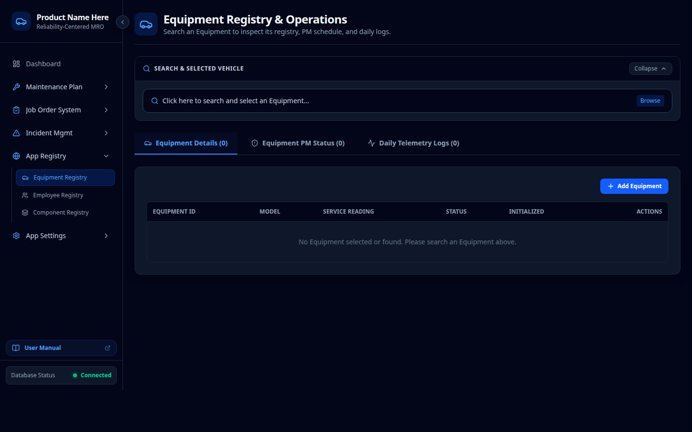
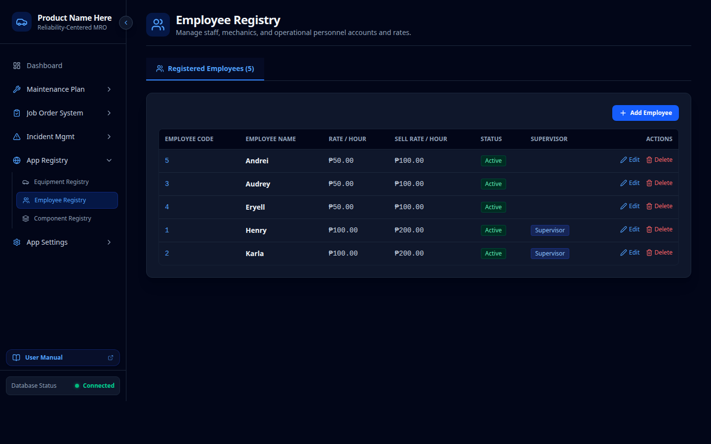
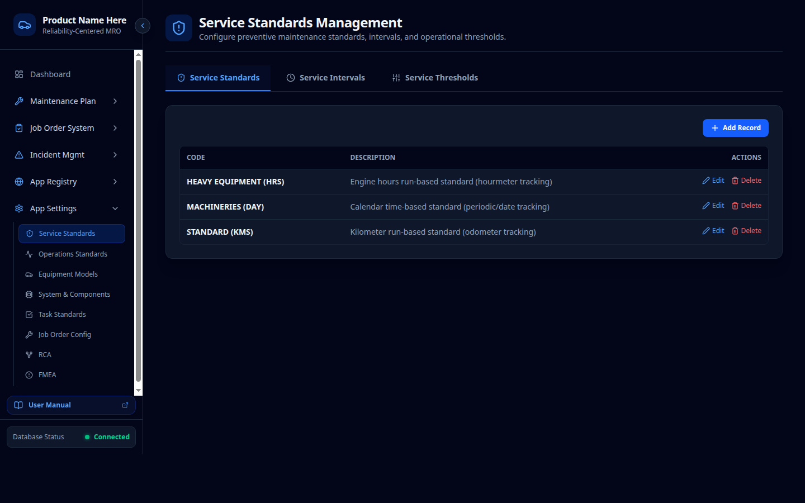
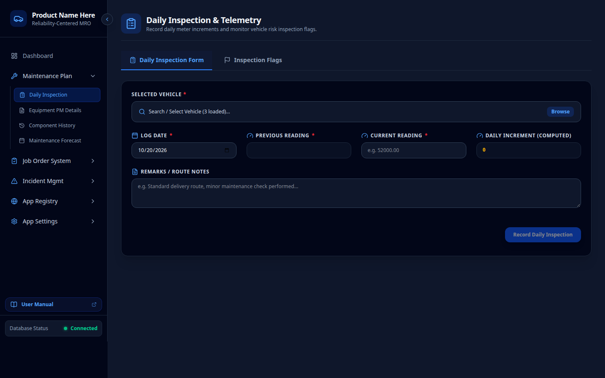
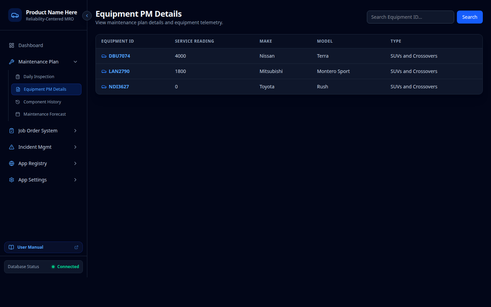
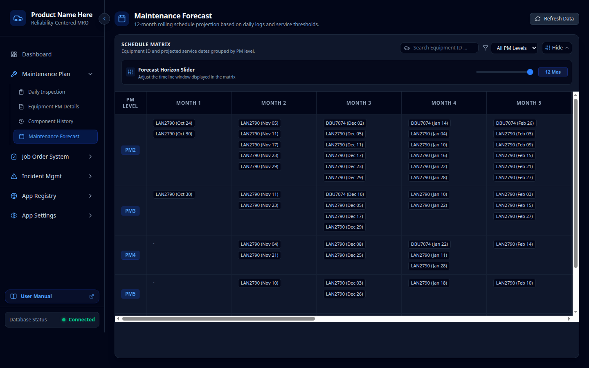
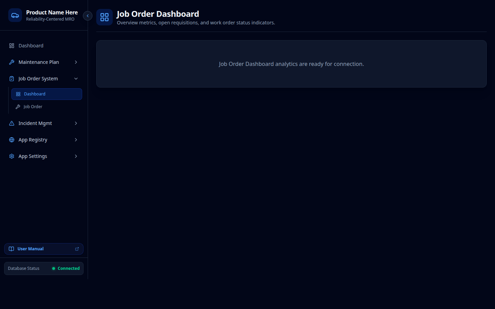
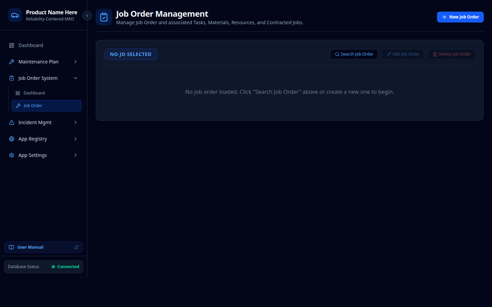
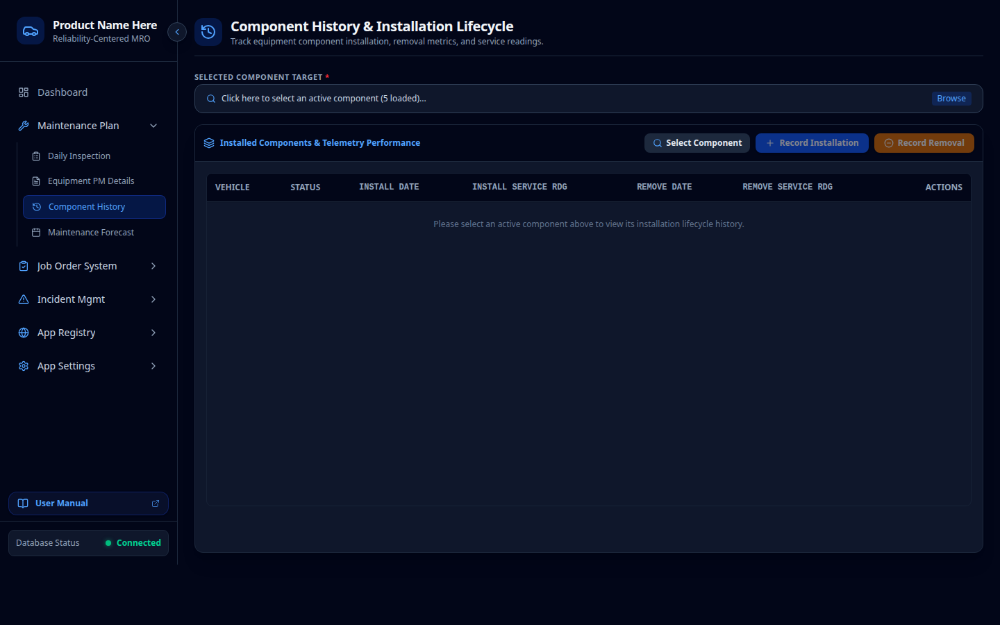
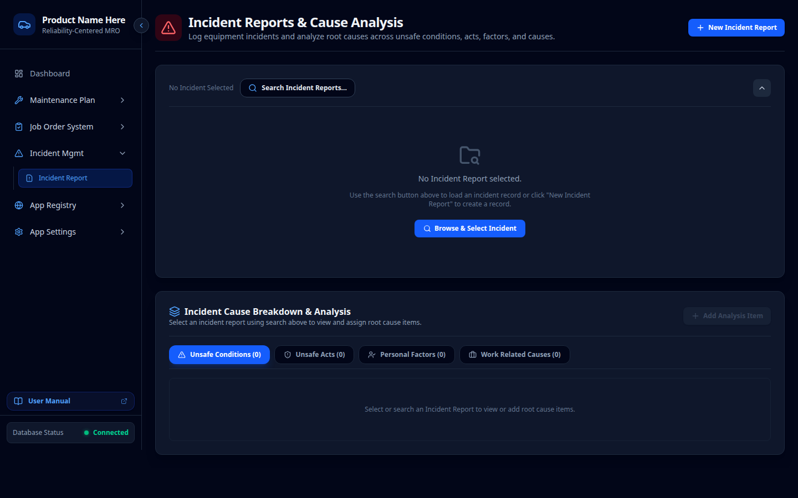

# Onyx MRO — Transaction Flow & Operations Manual
**Reliability-Centered Maintenance, Repair, and Overhaul Management System**

Version: 1.1.0  
Last Updated: October 2026  
Target Application: Onyx MRO (`onyxproject`)  
Interactive HTML Version: [`public/manual.html`](public/manual.html) (accessible in deployment at `/manual.html`)

---

## Complete MRO Transaction Lifecycle
```text
┌────────────────────────────────────────────────────────────────────────────────────────┐
│                          ONYX MRO TRANSACTION LIFECYCLE                               │
│                                                                                        │
│  [ Stage 1: Asset & Staff Setup ]                                                      │
│    ├─ Register Equipment Fleet & Initialize Baseline Reading                           │
│    ├─ Enroll Technicians with Internal Wage Cost & Billing Rates                       │
│    └─ Configure Service Standards & PM Intervals (PM2–PM7)                             │
│         │                                                                              │
│         ▼                                                                              │
│  [ Stage 2: Daily Operations & Telemetry ]                                             │
│    ├─ Inspector selects Equipment & enters shift-end Odometer reading                  │
│    ├─ System auto-computes Daily Increment = Current Reading − Previous Reading        │
│    └─ Optional: Link observed mechanical defects to FMEA Condition Risk Codes          │
│         │                                                                              │
│         ▼                                                                              │
│  [ Stage 3: Preventive Maintenance Monitoring ]                                        │
│    ├─ System detects Current Reading >= Target Threshold                               │
│    ├─ Triggers Overdue Red Flag in Equipment PM Details                                │
│    └─ Forward capacity evaluated in 12-Month Predictive Maintenance Forecast           │
│         │                                                                              │
│         ▼                                                                              │
│  [ Stage 4: Work Order (Job Order) Execution & Costing ]                               │
│    ├─ Create Job Order (Check-in Odometer, Priority, Target Handoff Date)              │
│    ├─ Assign Standard Tasks with benchmark labor hours                                 │
│    ├─ Issue Bill of Materials (BOM) parts & unit costs                                 │
│    ├─ Assign Technicians & calculate Labor Line = Hours × Wage Rate                    │
│    ├─ Log Outside Contractor / Subcontracted Services                                  │
│    └─ Real-Time Rollup: Total Cost = Labor + Materials + Contracts                     │
│         │                                                                              │
│         ▼                                                                              │
│  [ Stage 5: Maintenance Sign-Off & Counter Reset ]                                     │
│    ├─ Supervisor closes Job Order                                                      │
│    ├─ Opens Equipment PM Details and clicks "Completed" on flagged tier                │
│    └─ Database RPC completed_vehicle_pm() advances counter & clears flag               │
│         │                                                                              │
│         ▼                                                                              │
│  [ Stage 6: Component Rotation & Salvage Governance ]                                  │
│    ├─ Remove failed assembly, log vehicle reading & teardown reason                    │
│    ├─ Condemn cracked units with is_scrapped = TRUE                                    │
│    └─ Install newly rebuilt/new serialized unit with initial reading                   │
│         │                                                                              │
│         ▼                                                                              │
│  [ Stage 7: Safety Incident & 4-Pillar Root Cause Analysis ]                           │
│    ├─ Log breakdown occurrence, severity tier, and financial loss                      │
│    └─ 4-Pillar RCA: Substandard Conditions, Acts, Personal Factors, Causes             │
└────────────────────────────────────────────────────────────────────────────────────────┘
```

---

## Stage 1: Asset & Staff Onboarding (Foundation Setup)

### Step 1.1: Registering Fleet Equipment & Baseline Counters
* **Route**: `/global-settings/vehicle-registry`
* **Screenshot**: 
* **Action Steps**:
  1. Click **Add Equipment**.
  2. Input **Plate Number** (or Asset Code), **Conduction Sticker Number**, **Make**, and **Model**.
  3. Assign the **Service Standard Profile** (e.g., `STD-HEAVY` for prime movers, `STD-LIGHT` for passenger vans).
  4. Enter the starting **Baseline Service Reading** and toggle **Active Status** to `TRUE`.
  5. The system initializes the PM tracking registers (`pm2_current` through `pm7_current`).

### Step 1.2: Enrolling Technicians & Costing Rates
* **Route**: `/global-settings/employee-registry`
* **Screenshot**: 
* **Action Steps**:
  1. Click **Add Employee**.
  2. Enter **Employee Code** and **Full Name**.
  3. Specify **Rate Per Hour** (internal wage cost used for Job Order costing).
  4. Specify **Sell Rate Per Hour** (external/inter-departmental billing rate).
  5. Toggle `is_supervisor` if authorized to approve work orders and sign off on PM completions.

### Step 1.3: Setting Service Standards & Interval Increments
* **Route**: `/settings/service-standards`
* **Screenshot**: 
* **Standard Intervals**:
  * **PM2**: 5,000 km / 250 hrs (Minor Service: Oils, Lubrication, Safety Inspection)
  * **PM3**: 10,000 km / 500 hrs (Intermediate: Fuel & Air Filters, Brake Lining Check)
  * **PM4**: 20,000 km / 1,000 hrs (Major: Transmission/Differential Fluids, Alignment)
  * **PM5**: 40,000 km / 2,000 hrs (Hydraulic Flush, Cooling System, Bushings)
  * **PM6**: 80,000 km / 4,000 hrs (Refurbishment: Injectors, Turbocharger, Suspension)
  * **PM7**: 160,000 km / 8,000 hrs (Complete Driveline & Structural Overhaul)

---

## Stage 2: Daily Operations & Telemetry Capture

### Step 2.1: Shift End Telemetry Entry
* **Route**: `/daily-inspection`
* **Screenshot**: 
* **Action Steps**:
  1. Click the search icon in the **Vehicle Picker** to select the asset. The system auto-loads the **Previous Service Reading**.
  2. Input the **Current Service Reading** recorded from the vehicle's odometer/hour meter.
  3. The system calculates the daily distance:
     $$\text{Daily Increment} = \text{Current Service Reading} - \text{Previous Service Reading}$$
  4. Enter operator remarks and click **Submit Daily Log**. The vehicle's master mileage is updated immediately.
  5. *Optional*: If a defect is observed, open the **Inspection Flags** tab and link the log to an **FMEA Condition Risk Code**.

---

## Stage 3: Preventive Maintenance Monitoring & Execution

### Step 3.1: Equipment PM Monitoring & Overdue Flags
* **Route**: `/vehicles`
* **Screenshot**: 
* **Action Steps**:
  1. Locate the vehicle in the list and click **View Details**.
  2. Inspect the **PM Schedule Breakdown** table:
     * When $\text{Current Reading} \ge \text{Target Reading}$, the tier turns red and enables a green **Completed** button.
  3. When physical maintenance has been completed, click **Completed**.
  4. The system triggers the stored database procedure `completed_vehicle_pm(p_pm_level, p_vehicle_id)`:
     * Records completion timestamp.
     * Sets `Previous PM = Current Reading`.
     * Advances `Current PM = Next PM`.
     * Calculates `Next PM = Current PM + Interval`.
     * Clears the overdue red flag.

---

## Stage 4: 12-Month Predictive Capacity Planning

### Step 4.1: Forward Bay & Inventory Planning
* **Route**: `/maintenance-forecast`
* **Screenshot**: 
* **Action Steps**:
  1. Adjust the **Forward Horizon Slider** (1 to 12 months).
  2. Filter by PM tier (e.g., isolate major PM4 and PM6 services).
  3. Pre-order fast-moving filters, fluids, and allocate mechanic shop shifts based on predicted monthly arrival volumes.

---

## Stage 5: Job Order (Work Order) Execution & Costing

### Step 5.1: Work Order Triage Dashboard
* **Route**: `/job-orders/dashboard`
* **Screenshot**: 
* Review active workshop backlog, high-priority work orders, and open requisitions.

### Step 5.2: Creating & Costing the Work Order
* **Route**: `/job-orders`
* **Screenshot**: 
* **Action Steps**:
  1. **Header**: Select Equipment, In-Odometer Reading, Priority (`Urgent`, `High`, `Normal`, `Low`), Expected Completion, and Assigned Supervisor.
  2. **Standard Tasks**: Select tasks from the Task Standards library to automatically apply benchmark standard hours (e.g., 2.5 hrs).
  3. **Bill of Materials (BOM)**: Add OEM parts, stock codes, issued quantities, and unit prices. Sums into **Materials Cost**.
  4. **Labor Resources**: Assign technicians from the Employee Registry and enter charged hours. The system multiplies hours by technician wage rate and sums into **Labor Cost**:
     $$\text{Labor Line Total} = \text{Charged Hours} \times \text{Employee Hourly Rate}$$
  5. **Outside Contracts**: Log external vendor repairs (e.g., radiator recoring, machining). Sums into **Contract Cost**.
  6. **Grand Total Rollup**:
     $$\text{Total Cost} = \text{Labor Cost} + \text{Materials Cost} + \text{Contract Cost}$$
  7. Set **Status** to `Completed` or `Closed` once post-repair inspection passes.

---

## Stage 6: Component Provenance & Scrap Lifecycle

### Step 6.1: Component Installation, Teardown & Scrapping
* **Route**: `/component-history`
* **Screenshot**: 
* **Action Steps**:
  1. **Teardown / Removal**: Click **Remove Component**, enter removal date, vehicle reading, and teardown cause. The system calculates net operating hours accumulated.
  2. **Scrap Condemnation**: If casing cracks or terminal wear are found, mark `is_scrapped = TRUE` to prevent future mounting.
  3. **Installation**: Mount replacement rebuilt unit, input install date, initial reading, and technician notes.

---

## Stage 7: Safety Incident & 4-Pillar Root Cause Analysis

### Step 7.1: Logging Field Breakdowns & Investigation
* **Route**: `/incident-management/incident-report`
* **Screenshot**: 
* **Action Steps**:
  1. Log Incident Reference Number, Vehicle, Severity (`Low`, `Medium`, `High`, `Critical`), and Financial Loss Estimate.
  2. Populate the **4-Pillar Root Cause Analysis**:
     * **1. Substandard Conditions**: Mechanical failure (e.g., hydraulic hose burst).
     * **2. Substandard Acts**: Operator behavior (e.g., operating with warning lamp active).
     * **3. Personal Factors**: Human drivers (e.g., fatigue, lack of training).
     * **4. Work-Related Causes**: Systemic defects (e.g., inadequate PM inspection checklist).
  3. Update Master RCA and FMEA libraries ([RCA Settings](public/screenshots/flow_11_rca_settings.png) & [FMEA Settings](public/screenshots/flow_12_fmea_settings.png)) to close the reliability loop.

---

## Web-Accessible HTML Manual
The interactive HTML manual complete with image zoom lightboxes, real-time search, and sequence diagrams is accessible in the web app:
* **Web Route**: [`/manual.html`](public/manual.html)
* **In-App**: Accessible via the **User Manual** button above the Database Status indicator in the navigation sidebar.
